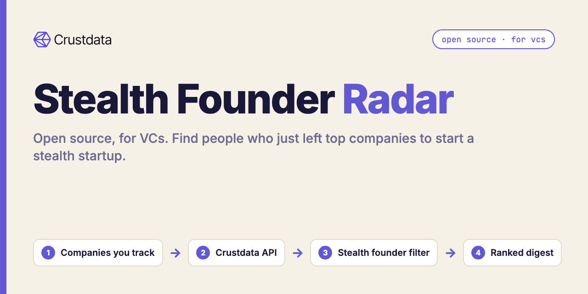
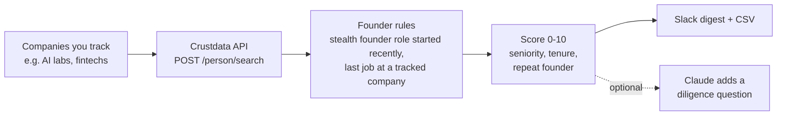

# Stealth Founder Radar (Open Source, for VCs)

**An open-source Python tool that finds people who just left top companies to start a stealth startup, ranks them, and posts a weekly digest to Slack.**

The best founders are easiest to meet before they announce anything. Their profile says "Founder, Stealth" weeks before there is a website. This radar searches for exactly that change, keeps only people who really left a job at a company you care about, and gives you a short ranked list. [Crustdata](https://crustdata.com) is the people data layer ([API docs](https://docs.crustdata.com)).



## How it works



1. **Search.** One `POST /person/search` call: current title contains "Founder", current company or title contains "Stealth", that role started inside the window, and a past employer domain is in your list. Optional country filter.
2. **Filter.** Search filters match any role in a profile, so the tool re-checks every profile in code:
   - the stealth founder role itself started inside the window,
   - the person's most recent ended job was at a tracked company (not a stop somewhere else in between),
   - they left inside the window you set,
   - that last job was a real job, not an internship, advisor seat or open source contribution.
3. **Score.** A transparent 0-10 score: +2 for a senior or staff-level last title, up to +3 for tenure at the tracked company, +2 for a previous founder role. Change the weights in `score()`.
4. **Alert.** New founders only (remembered in `.state/seen.json`), posted to Slack and saved to `out/founders.csv`.

## Quickstart

Requires Python 3.9+. No dependencies for the core tool.

```bash
git clone https://github.com/mhimed-crustdata/stealth-founder-radar
cd stealth-founder-radar
make setup        # creates .env, then add your CRUSTDATA_API_KEY
make demo         # runs the radar and prints the summary, never posts to Slack
make run          # posts new founders to SLACK_WEBHOOK_URL
make test         # unit tests, no network
```

Run it weekly with cron (`0 8 * * 1 cd /path/to/repo && make run`) or a scheduled CI job with your keys stored as secrets.

## Configuration

All settings live in `.env` (copy from `.env.example`). Command-line flags override them.

| Variable | Default | What it does |
|---|---|---|
| `CRUSTDATA_API_KEY` | required | Your Crustdata API key. Read from the environment only |
| `TRACKED_COMPANIES` | `openai.com,anthropic.com,deepmind.google,stripe.com,databricks.com,ramp.com,figma.com,scale.com` | Website domains of the companies whose alumni you track |
| `SINCE_DAYS` | `90` | The stealth founder role started in the last N days |
| `LEFT_WITHIN_DAYS` | `270` | They left the tracked company in the last N days |
| `COUNTRY` | empty (worldwide) | Person location, e.g. `United States` |
| `SLACK_WEBHOOK_URL` | empty | Slack incoming webhook. Empty means no Slack post |
| `ANTHROPIC_API_KEY` | empty | Optional. With `--notes`, Claude adds one "first question to ask" per founder |
| `ANTHROPIC_MODEL` | `claude-opus-5-5` | Model for the optional Claude step |

Useful flags: `--dry-run`, `--all` (include founders already sent), `--max-results N`, `--out DIR`.

Output files in `out/` (`founders.csv`, `founders.json`) contain personal data and are git-ignored.

## Example output

A real run on 2026-10-18 against the live API with the default 8 companies, stealth role started in the last 110 days, left in the last 300 days, worldwide. Individuals are not shown. Aggregated from `out/founders.json`:

```json
{
 "profiles_scanned": 48,
 "stealth_founders": 13,
 "by_last_company": {"OpenAI": 5, "Anthropic": 2, "Ramp": 2, "4 other tracked companies, 1 each": 4},
 "by_country": {"United States": 11, "Ireland": 1, "Canada": 1},
 "repeat_founders": 3,
 "last_role": {"Engineering": 6, "Member of Technical Staff": 4, "Other": 3},
 "score": {"8": 2, "7": 2, "5": 7, "3": 2}
}
```

The code filters cut 48 search matches to 13: most of the rest had a more recent job somewhere other than the tracked companies, had left long ago, or had only an internship or advisory role there.

What the Slack digest looks like (redacted):

```text
:telescope: Stealth Founder Radar: 13 new stealth founders since 2026-06-30
• [Name] (8/10) ex-[Tracked company] [Senior title], left [YYYY-MM], stealth since [YYYY-MM] profile
• [Name] (7/10) ex-[Tracked company] [Engineering title], left [YYYY-MM], stealth since [YYYY-MM] profile
…and 11 more
```

## How to build a stealth founder sourcing agent

1. **Define "stealth founder" as data.** A current role with a founder title, a company or title containing "Stealth", and a start date in your window.
2. **Define the pedigree.** A list of employer domains, not names, so "Google DeepMind" and "DeepMind" resolve to one company. Filter on `experience.employment_details.past.company_website_domain`.
3. **Re-check nested matches in code.** Search conditions on a profile's roles can each match a different role. Confirm the founder role and the last job on the same profile before you trust a hit (`qualify()` in `radar.py`).
4. **Rank with rules you can explain to a partner.** Seniority, tenure and repeat-founder status are a good start. Add your own: school, past exits, team size at the last company.
5. **Send only what's new.** Keep a seen-list so the Monday digest is short.
6. **Use the model for the note, not the list.** The optional Claude step suggests the first diligence question. It never adds or removes founders.
7. **Go live.** For near real-time sourcing, Crustdata also offers watch endpoints that push new matches; see the [docs](https://docs.crustdata.com).

## FAQ

**How do VCs find stealth startups early?**
Most stealth founders update their own profile with a "Stealth" company and a founder title well before launch. Searching for that change across alumni of strong companies is one of the earliest public signals.

**Why do I need the code filters if the search already filters?**
Because a profile has many roles. A search can match "founder" on one role and "Stealth" on another, or match a past employer from ten years ago. The filters in `radar.py` remove those.

**Can I track universities or accelerators instead of companies?**
The same pattern works. Swap the past-employer condition for an education filter (see the Person Search reference in the [Crustdata docs](https://docs.crustdata.com)).

**Does it contact founders?**
No. It only posts to your own Slack webhook when `SLACK_WEBHOOK_URL` is set and `--dry-run` is off.

**Is Claude required?**
No. It is optional and off unless `ANTHROPIC_API_KEY` is set and you pass `--notes`.

**Which Crustdata endpoint does it use?**
`POST /person/search` on API version `2025-11-01`.

## Project layout

```text
radar.py            # the workflow: search, qualify, score, output
crustdata_api.py    # tiny Crustdata client (stdlib only)
notify.py           # optional Slack + Claude
tests/              # unit tests, no network
```

## License

MIT. See [LICENSE](LICENSE). Data layer: [Crustdata](https://crustdata.com) ([docs](https://docs.crustdata.com)).
